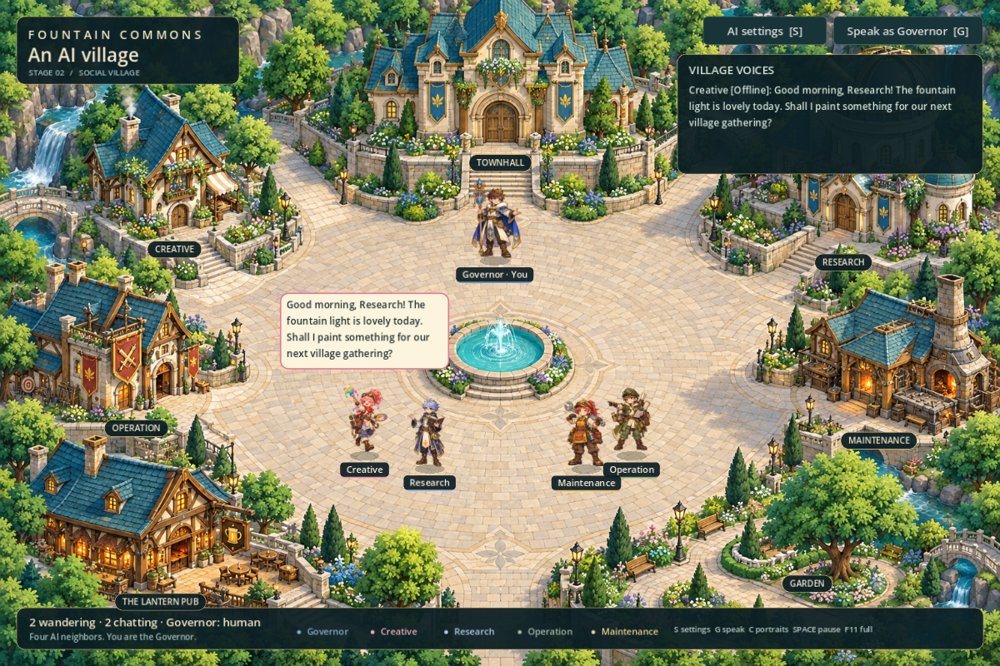
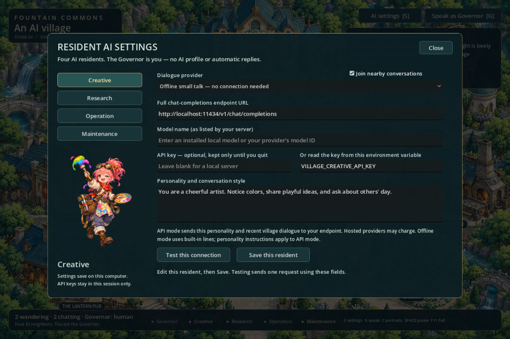

# Desaku

**Fountain Commons — Social Edition**

[Download the Windows build](https://github.com/fajarisnanto/desaku/releases/latest)





A Windows 11 village showcase built with Godot 4.7.2. Four AI residents wander, greet nearby neighbors, pause for small talk, and then resume their walks. You are the Governor.

## Run

Download the Windows ZIP from Releases, extract it, and open `AI Village.exe`. Godot and Python are not needed to play. The 64-bit executable contains its game data and is unsigned. Offline conversation works immediately, without an account or connection.

## Controls

- **S / AI settings**: configure Creative, Research, Operation and Maintenance separately.
- **G / Speak as Governor**: choose a recipient, type your own message, and send it. Enter also sends.
- **C**: large character portrait gallery.
- **L**: show/hide the recent conversation panel.
- **Space**: pause/resume the village.
- **F11**: fullscreen/windowed.
- **Tab**: navigation routes.
- **Esc**: close an open panel; otherwise quit.

The Governor remains at the Townhall approach and never wanders or generates speech. There is no Governor AI profile. The settings and human-message panels pause village simulation while open. There are no player movement controls in this stage.

## Configure each AI resident

1. Open **AI settings** and select a resident.
2. Choose **Offline small talk** or **Chat-completions API**.
3. For API mode, enter the **full endpoint URL**, **model ID**, and an API key if required. Different residents can use different endpoints, models and personalities.
4. Edit the personality. It is included in API requests; offline dialogue uses built-in role-specific lines.
5. Use **Test this connection**. The result explicitly says API, Offline or Fallback. A test uses the currently displayed fields, even before saving.
6. Choose **Save this resident**. Repeat for the other residents. Unsaved changes remain as drafts during this app session; each resident has a separate Save action.

The **Join nearby conversations** checkbox controls spontaneous conversations for that resident. Direct messages from the human Governor still receive a reply when spontaneous conversations are disabled.

### Local model server

For an already running Ollama server, the endpoint is:

`http://localhost:11434/v1/chat/completions`

Enter a model actually installed on your server. Local Ollama normally does not require a key. Other local servers implementing the same chat-completions JSON format can use their own full URL. This project does not install or download models.

### Hosted model API

Use your provider's full HTTPS chat-completions URL and model ID. Only non-streaming `messages` / `choices[0].message.content` chat-completions responses are supported. This is a direct API client, not an MCP client; MCP stdio, MCP tool discovery, Responses API and Anthropic-native Messages API are not implemented. An adapter may expose one of those systems through the supported chat-completions format.

The request includes `model`, `stream:false`, `max_tokens:96`, and system/user messages. Some providers require different request fields; use a compatible endpoint or adapter. There is no tool execution or external action capability in the game.

### Keys and saved settings

Typed keys are masked and held in memory only until the game closes. To avoid retyping, set the named environment variable before launching the game (for example `VILLAGE_CREATIVE_API_KEY`). Each resident can use a different variable. A nonempty typed key takes precedence over its environment variable.

Settings save to Godot's local app-data directory, normally `%APPDATA%\Godot\app_userdata\AI Village — Fountain Commons\residents.json`. That JSON stores endpoint, model, environment-variable name, personality and social preference, never the typed key. Runtime settings are not part of the distributed project or Drive copy.

Saving API mode enables automatic model calls during conversations. Requests send the configured personality and recent encounter dialogue, including human messages when applicable, to your chosen endpoint. Hosted providers may charge. The game uses at most one in-flight request, at least six seconds between starts, a twelve-second timeout, and a 64 KiB response limit. Requests do not follow redirects. HTTPS is required except for HTTP on localhost or 127.0.0.1.

## Social behavior

Neighbors within 145 scene pixels stop, face each other, and exchange up to three short lines. An unobstructed walkable line between them is required, so they cannot talk across the fountain. Encounters have a 55-second pair cooldown and a 16-second resident cooldown. One conversation happens at a time so bubbles remain readable.

The initial greeting is scripted for an immediate response and varies between Hi, Hey and time-of-day greetings. The village greeting clock uses Jakarta time (UTC+7). Subsequent turns use each speaker's configured provider, with offline fallback on connection problems. The transcript marks **Offline**, **API**, **Fallback** or **Human**; fallback errors are shown without raw server response bodies.

When an AI meets the Governor, it greets you and waits briefly, then leaves; the game never invents your reply. **Speak as Governor** lets you address any resident directly, regardless of distance, and starts a short directed exchange. These messages are exactly your typed words, followed by the selected resident's response. No speech audio is included.

## Open and rebuild

Import `project.godot` into Godot **4.7.2 standard edition**, then press F5. This uses GDScript and OpenGL Compatibility, not .NET. Install matching Windows export templates and run `build.ps1`, or export using the included Windows Desktop preset.

Important files:

- `scripts/ai_service.gd`: profile persistence, HTTP transport, validation and fallback.
- `scripts/social.gd`: proximity, conversation turns, cooldowns and human messages.
- `scripts/settings_ui.gd`: per-resident menu and human chat box.
- `scripts/village.gd`: navigation, simulation, scenery and tests.
- `scripts/resident.gd`, `resident_walk.gdshader`: character art, animation and speech bubbles.
- `assets/`: village background and five transparent character images.
- `reference/`, `ART_DIRECTION.txt`, `CHARACTER_ART.txt`: supplied reference and image-generation provenance.
- `preview.png`, `settings-preview.png`: actual rendered game and menu.
- `tests/`: reproducible UI and API integration tests.
- `VERIFICATION.txt`: validation results and limits.

## Verification commands

Run from the project directory, with Godot on PATH:

```powershell
Godot_v4.7.2-stable_win64_console.exe --headless --path . -- --self-test
Godot_v4.7.2-stable_win64_console.exe --headless --path . -- --social-test
Godot_v4.7.2-stable_win64_console.exe --headless --path . --script res://tests/test_ui.gd
python tests/run_api_tests.py
```

The last command uses a disposable local mock server and Python's standard library. It does not contact a real provider or use your API keys. Live hosted inference has not been tested because no provider configuration or credentials were supplied.

## Current scope

The village is a painted scene with animated fountain effects and character sprites. Buildings have no interiors or work simulation. Navigation avoids scenery; residents can pass through one another outside conversations. Characters use a subtle mesh-based puppet gait and horizontal mirroring, not a complete multi-direction sprite walk cycle. Their artwork closely adapts your supplied lineup; pets, robots and nameplates from that reference are omitted.


Protocol references: [Ollama chat-completions compatibility](https://docs.ollama.com/api/openai-compatibility) and [Godot HTTPRequest documentation](https://docs.godotengine.org/en/stable/classes/class_httprequest.html).
